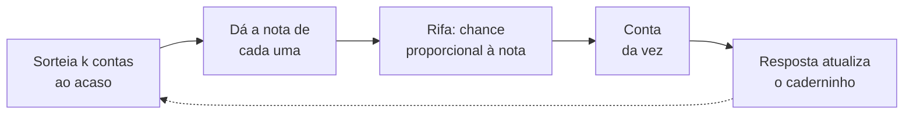
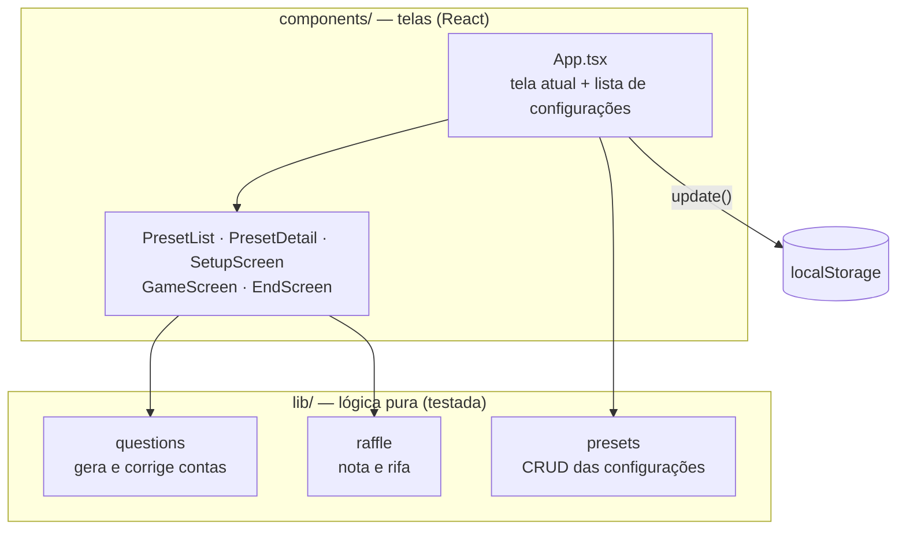

# 🧮 Caderno de Contas

**Treino de contas que sorteia com mais frequência o que você ainda erra ou demora.**


Você escolhe as operações e os intervalos de números (por exemplo, tabuada do 6 ao 9). O app sorteia as contas e anota, para cada uma, quantas vezes você errou e quanto tempo levou. Com essas anotações, o *caderninho*, as contas difíceis voltam mais vezes e as que você já sabe aparecem menos.

---

## Sumário

- [Como rodar](#-como-rodar)
- [Como funciona](#-como-funciona)
- [O sorteio](#-o-sorteio)
- [A geração das contas](#-a-geração-das-contas)
- [O salvamento dos dados](#-o-salvamento-dos-dados)
- [Arquitetura](#-arquitetura)
- [Estrutura de pastas](#-estrutura-de-pastas)

---

## 🚀 Como rodar

```bash
npm install
npm run dev      # servidor de desenvolvimento
npm test         # testes (Vitest)
npm run build    # checagem de tipos + build de produção em dist/
```

## 🎮 Como funciona

1. **Crie uma configuração:** escolha as operações (soma, subtração, multiplicação, divisão), os intervalos de cada lado, as casas decimais, a ordem dos números e a duração da partida.
2. **Jogue:** responda e aperte Enter. Cada acerto vale mais pontos quanto mais difícil é a conta.
3. **Acompanhe:** cada configuração tem os próprios gráficos de pontos, aproveitamento e tempo médio por partida.

Cada configuração guarda o próprio caderninho e a própria evolução. Assim, treinar tabuada não interfere no treino de divisão com decimais.

---

## 🎲 O sorteio

O sorteio é a parte central do app. A ideia é simples: **toda conta tem uma nota de dificuldade, e quem tem nota maior tem mais chance de sair.**

### 1. A nota de dificuldade (1 a 10)

```
nota = 1 + 6 × taxa de erro + 3 × lentidão
```

| Parte | Cálculo | Peso |
|---|---|---|
| **Taxa de erro** | `(erros + 1) / (tentativas + 2)` | até 6 pontos |
| **Lentidão** | 0 se a média for até 2 s, 1 se for 8 s ou mais, proporcional no meio | até 3 pontos |

- **Errar pesa mais que demorar.** Errar mostra que você não sabe a conta. Demorar mostra que ainda não está no automático.
- **O `+1` e o `+2` evitam extremos.** Um erro na primeira tentativa dá 67%, não 100%, e uma conta nunca respondida começa em 50%. Poucas respostas não condenam nem absolvem uma conta.
- **O tempo médio é uma média móvel** (`70% da média antiga + 30% da resposta nova`). Ela segue sua evolução recente sem esquecer o histórico.

| Situação | Nota |
|---|---|
| Nunca apareceu | **5,0**, no meio da escala, para contas novas aparecerem sem dominar |
| Saiu numa das últimas 3 contas | **0,1**, quase nunca repete em seguida |
| Rápida e sempre certa | perto de **1** |
| Lenta e sempre errada | perto de **10** |

> **Exemplo:** `7 × 8`, com 3 tentativas, 2 erros e média de 6 s.
> Taxa de erro `(2+1)/(3+2) = 0,6`, então `6 × 0,6 = 3,6`. Lentidão `(6−2)/(8−2) ≈ 0,67`, então `3 × 0,67 = 2,0`.
> **Nota = 1 + 3,6 + 2,0 = 6,6**

### 2. A rifa entre *k* candidatas

Em vez de calcular a nota de todas as contas possíveis, o app sorteia **k candidatas** ao acaso. Depois faz uma rifa entre elas, em que cada uma recebe "bilhetes" proporcionais à própria nota.



| Candidata | Nota | Chance |
|---|---|---|
| `3 + 4` (nova) | 5,0 | 39% |
| `7 × 8` | 6,6 | 51% |
| `2 × 5` | 1,2 | 9% |
| `6 × 9` (recente) | 0,1 | 1% |

**Por que não pesar todas as contas de uma vez?** Porque o universo pode ser enorme: um intervalo de 0 a 1.000 com duas casas decimais tem bilhões de pares. Com *k* candidatas, o custo é o mesmo para qualquer tamanho de intervalo.

Esse *k* também vira uma opção para o usuário: o controle **"Foco nas difíceis"** (1 a 10).
- `k = 1` é o sorteio comum, sem peso nenhum.
- Quanto maior o `k`, mais candidatas competem e mais vezes as difíceis ganham.

As notas nunca são zero. Mesmo uma conta recente tem 0,1, então o sorteio sempre termina, inclusive quando a configuração só permite 2 ou 3 contas diferentes.

### 3. Pontuação

Um acerto vale a nota arredondada da conta (mínimo 1). Acertar `7 × 8` vale 7 pontos, e acertar `2 × 5` vale 1. Erro vale zero.

---

## 🔢 A geração das contas

Antes da rifa, cada candidata é gerada respeitando todas as regras da configuração.

| Regra | Como é resolvida |
|---|---|
| **Casas decimais** | Os números são sorteados como inteiros num intervalo multiplicado por 10ⁿ e divididos no final. Para 0 a 10 com 1 casa, sorteia entre 0 e 100, sai 37 e a conta usa 3,7. Assim a lógica de ordem e de intervalo só trabalha com inteiros, sem erro de ponto flutuante. |
| **Ordem (esq. ≥ dir. ou esq. ≤ dir.)** | Primeiro estreita o intervalo da esquerda para garantir que exista pelo menos uma direita válida. Depois sorteia a direita a partir da esquerda escolhida. Não há tentativa e erro. |
| **Divisão com resultado inteiro** | Monta a lista de divisores possíveis e, para cada um, quais múltiplos cabem no intervalo do dividendo. Sorteia um divisor e depois um múltiplo, então a divisão é **sempre exata**. As últimas 20 listas ficam em cache. |
| **Divisão com casas no resultado** | Qualquer par vale, menos divisor zero. A resposta é aceita arredondada (`10 ÷ 3`, 2 casas, aceita `3,33`) ou com mais casas, se você digitar. |
| **Configuração impossível** | A tela mostra quantas contas diferentes a configuração permite enquanto você digita. Se o resultado for zero, ela não deixa salvar. |

Respostas como `0,1 + 0,2` são comparadas com tolerância, então `0,3` está certo.

---

## 💾 O salvamento dos dados

Não há servidor nem login. **Tudo fica no `localStorage` do navegador.**

### O que é salvo

| Chave | Conteúdo |
|---|---|
| `cc.presets` | A lista de configurações, cada uma com o caderninho e a evolução |
| `cc.muted` | Se o som está desligado |

```jsonc
{
  "id": "…",                    // crypto.randomUUID()
  "name": "Tabuada do 6 ao 9",
  "settings": { … },            // operações, intervalos, ordem, duração, k
  "stats": {                    // o caderninho: uma entrada por conta
    "multiplication:7:8": { "attempts": 3, "wrongs": 2, "avgMs": 6000 }
  },
  "scores": [                   // uma linha por partida completa
    { "at": 1730000000000, "done": 20, "rights": 17, "score": 84, "avgMs": 3100 }
  ],
  "edits": [1730100000000]      // quando a configuração foi editada
}
```

### Decisões

- **O caderninho é salvo a cada resposta,** não só no fim da partida. Fechar a aba no meio não perde nada do que você já respondeu.
- **Só partidas completas entram na evolução.** Comparar 20 contas com 5 seria injusto. A partida encerrada antes do fim atualiza o caderninho, mas não gera ponto no gráfico. No modo "até eu parar", entra qualquer partida com pelo menos uma resposta.
- **A chave do caderninho é a própria conta** (`multiplication:7:8`). Por isso, editar os intervalos não invalida nada: contas que saem do intervalo só deixam de ser sorteadas, e as novas entram como "nova".
- **Editar mantém o histórico, mas marca a mudança.** Os gráficos mostram uma linha tracejada onde a configuração mudou, para ninguém comparar sem querer pontos de regras diferentes. "Duplicar" cria uma cópia com tudo zerado. Mudar só o nome não gera marca.
- **Migração automática:** versões antigas tinham uma configuração e um caderninho só (`cc.settings` e `cc.stats`). Na primeira abertura, eles viram a primeira configuração salva.
- **Falha silenciosa:** se o navegador bloquear o armazenamento (modo privado, por exemplo), o app funciona normalmente, só não guarda.

> ⚠️ Como os dados ficam no navegador, limpar os dados do site ou trocar de aparelho começa tudo do zero.

---

## 🏗️ Arquitetura



- **Lógica separada da interface.** Tudo em `lib/` é função pura: recebe dados e devolve dados novos, sem mutar nada e sem tocar na tela. É o que está coberto por testes.
- **Um único ponto de gravação.** As funções de `presets.ts` devolvem uma lista nova, e `App.tsx` salva tudo numa função só, `update()`. Ela sempre parte da lista mais recente, porque na última conta da partida o caderninho e o resultado chegam no mesmo clique.
- **Sem router.** São seis telas controladas por um estado no `App`. Para o tamanho do app, uma biblioteca de rotas seria peso sem ganho.
- **Sem dependências além do React.** Os gráficos de evolução são SVG feito à mão, e o cronômetro é um componente isolado para só ele re-renderizar a cada 100 ms.
- **Visual 8 bits** com fontes pixeladas, cantos serrilhados e modo escuro automático, conforme o sistema.

---

## 📁 Estrutura de pastas

```
src/
├── App.tsx              # liga as telas e salva os dados
├── main.tsx             # ponto de entrada
├── style.css
├── components/
│   ├── PresetList.tsx   # tela inicial: configurações salvas
│   ├── PresetDetail.tsx # resumo, gráficos e ações de uma configuração
│   ├── SetupScreen.tsx  # criar / editar configuração
│   ├── OpCard.tsx       # bloco de uma operação no formulário
│   ├── GameScreen.tsx   # partida
│   ├── EndScreen.tsx    # fim da partida
│   ├── ScoreChart.tsx   # gráfico de evolução (SVG)
│   └── Timer.tsx        # cronômetro da conta atual
└── lib/
    ├── config.ts        # constantes e configuração padrão
    ├── types.ts
    ├── questions.ts     # geração, contagem e correção das contas
    ├── raffle.ts        # nota de dificuldade, rifa e caderninho
    ├── presets.ts       # configurações salvas
    ├── setupForm.ts     # rascunho e validação do formulário
    ├── storage.ts       # localStorage com proteção
    ├── sounds.ts        # efeitos sonoros
    └── format.ts        # números no padrão brasileiro
```
